
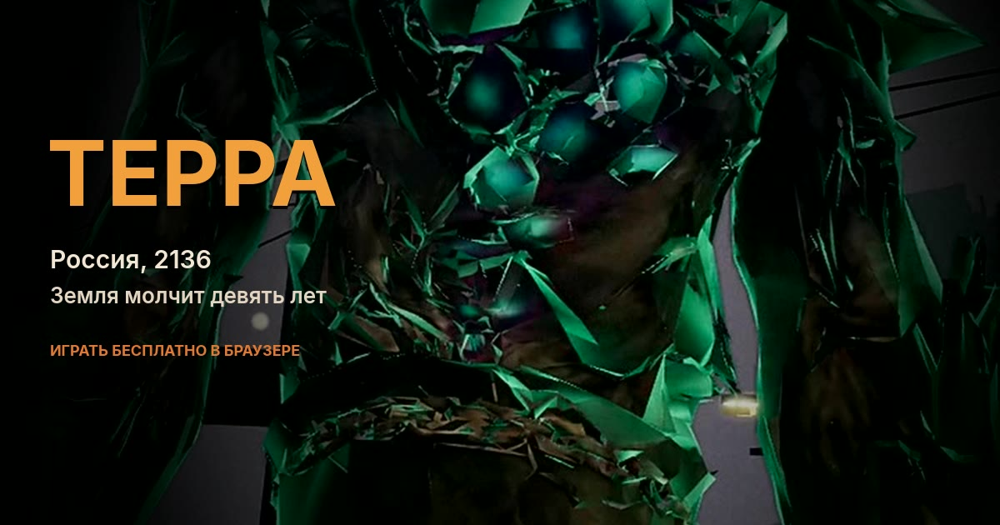

<h1 align="center">ТЕРРА — Россия, 2136</h1>

  
  
  

<b>Ты вернулся с Марса. Земля молчит девять лет.</b> Играть бесплатно в браузере — ПК и Android, без установки.

Капсула падает у мёртвого лагеря. В эфире пусто. Города заросли спорами, по улицам бродят мутанты, и ты, похоже, последний человек.

Не последний. Где-то ещё горят костры.

## Трейлеры

  <a href="assets/media/terra_trailer1.mp4">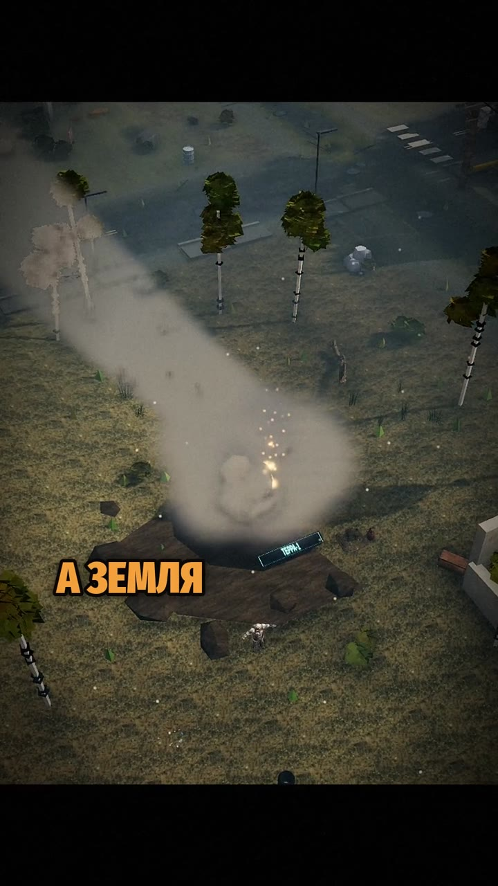</a>
  &nbsp;&nbsp;
  <a href="assets/media/terra_trailer2.mp4">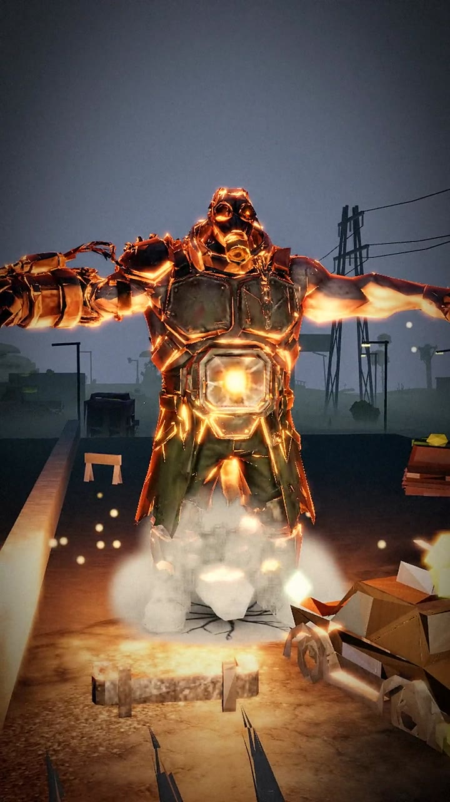</a>

Слева — сюжет, 30 секунд. Справа — что умеет игра. На <a href="https://89244114832maxim-ai.github.io/terra-play/">сайте</a> ролики сами крутятся в рамке. Звук включается кнопкой.

## О чём игра

Экспедиция «Арес-7» возвращается с Марса. Капсула «ТЕРРА-1» входит в атмосферу над Россией — а внизу тишина длиной в девять лет.

Сначала ты один: палка, пустой рюкзак, ночь. Потом в эфире находится «Рассвет». Выжившие реальны. Путь — от одиночки к общине, лагерю и защищённому городу.

## В игре

- **Открытый мир.** Пять поясов опасности: Окраина, Спальные кварталы, Мёртвый город, Красная зона, Эпицентр.
- **Оружие.** Палка, катана, двустволка, рельсотрон. Ещё гранаты, мины, капканы, дрон и турель.
- **Четыре босса мира.** Чернобор, Кукловод, «Молох», Костяная Царица. В подземельях — Мясник и Матка спор.
- **Лут, крафт, заточка до +16.** Шесть редкостей. Одинаковое сливается в более редкое.
- **Лагерь и выжившие.** Инженер, медик, разведчик, охранник, фермер, торговец. Стены, вышки, набеги.
- **Браузер.** ПК и Android, Chrome. Ничего не ставить. Сенсор и мышь. Около 20 МБ.

## Скриншоты

| | |
|---|---|
| 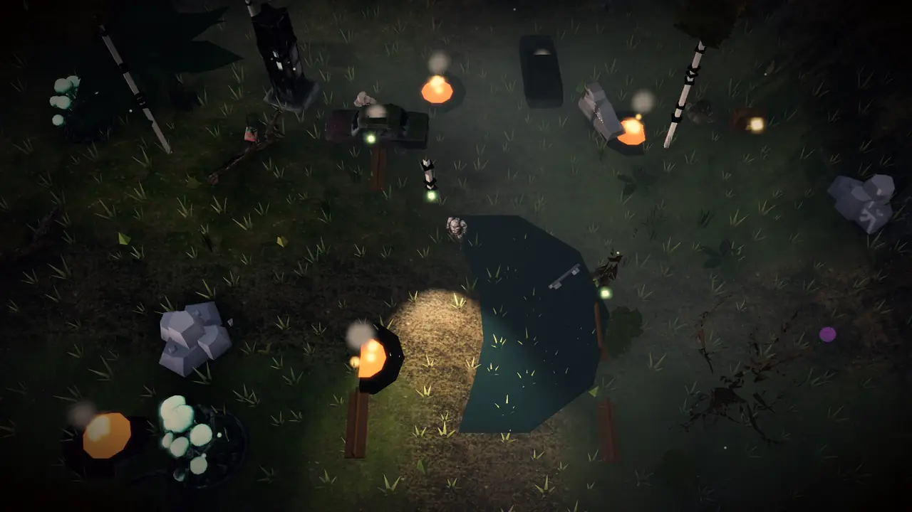 | 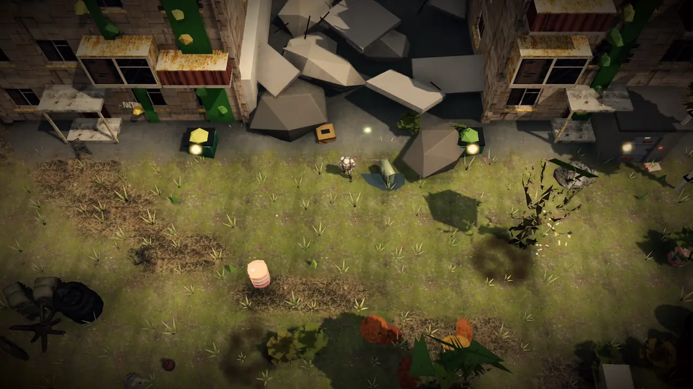 |
| 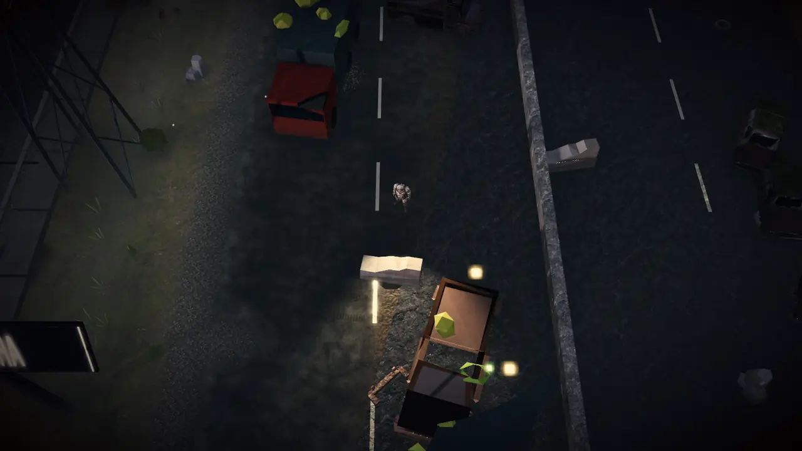 | 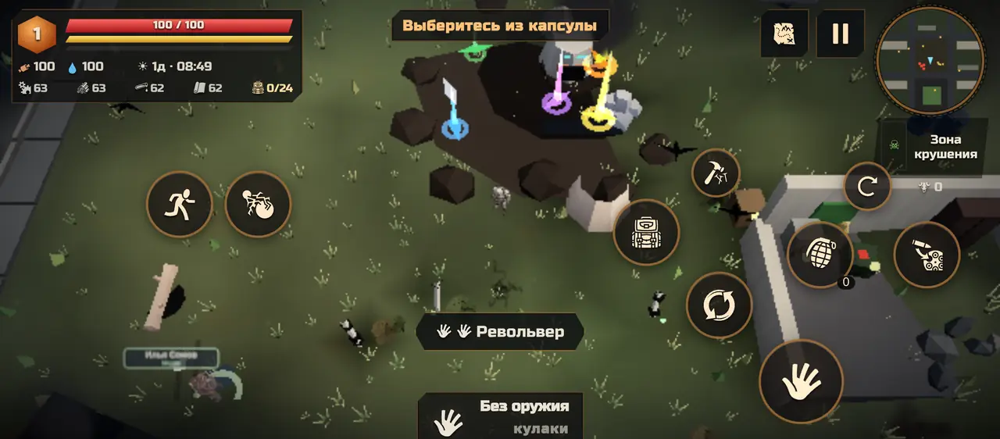 |

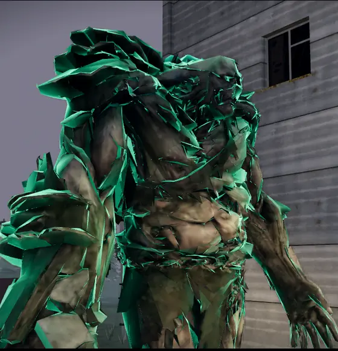 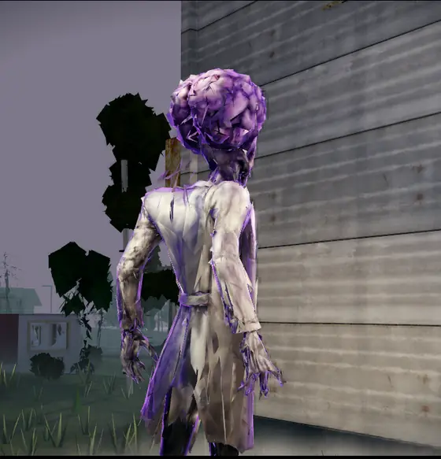 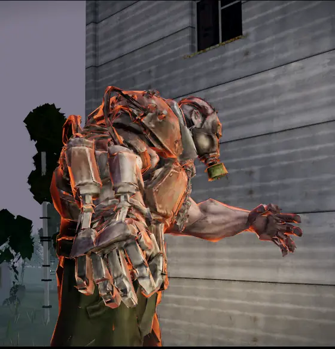 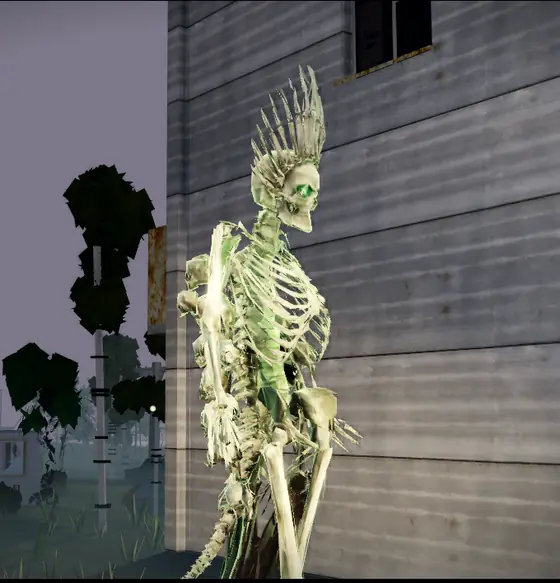

## Как играть

**Играть бесплатно в браузере — ПК и Android, без установки.**

- **Онлайн:** [89244114832maxim-ai.github.io/terra-play/play](https://89244114832maxim-ai.github.io/terra-play/play/) в Chrome.
- **Офлайн:** `terra.zip` из [последней сборки](https://github.com/89244114832maxim-ai/terra-play/releases/latest). Распакуй и открой `terra.html`.

**ПК:** WASD — ходьба, мышь — прицел, ЛКМ — атака, Shift — бег, E — действие, удержание Q — колесо оружия, I — рюкзак, M — карта, B — строительство.

## Команда

Игру делает команда «Терра» из **Иркутска**. Руководит проектом **Сергей Карачицев**. Ранний доступ, сборки выходят часто.

## Обратная связь

- 🐞 [Баг](https://github.com/89244114832maxim-ai/terra-play/issues/new?template=bug.yml). Напиши модель телефона и браузер.
- 💡 [Идея](https://github.com/89244114832maxim-ai/terra-play/issues/new?template=idea.yml): оружие, босс, район, механика.

## Технологии

Three.js и WebGL 2, Web Audio, PBR-атласы, Bloom, SSAO и ACES. Толпы — через VAT, модели — meshopt, текстуры — WebP, мир собирается по seed. Вся игра — один HTML-файл, около 20 МБ.

## Авторы ассетов

Свободные ассеты Kenney, Quaternius, Poly Haven, ambientCG, Atomic Realm, Grigory Petrov, OpenGameArt и иконки game-icons.net (CC BY 3.0). Список с лицензиями — в [credits.html](https://89244114832maxim-ai.github.io/terra-play/credits.html).

© 2026 Команда «Терра», Иркутск
